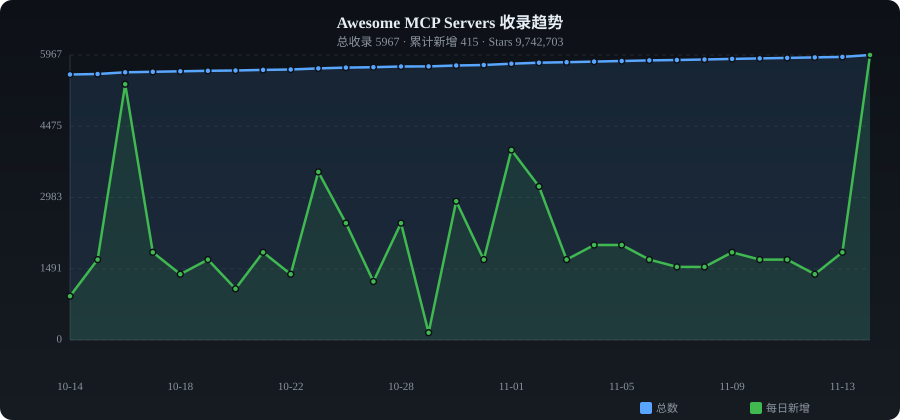

# ✨ Awesome MCP Servers

**English** | [中文](./README_ZH.md)

> Curated collection of MCP servers, clients & SDKs — auto-collected from GitHub

   

---

## 📈 Trends

---

## 📊 Category Stats

| Category | Count | Share |
|----------|------:|------:|
| 🏛️ Official & Reference | 315 | █ 5.3% |
| 🗄️ Database | 222 | █ 3.8% |
| ☁️ Cloud & Infrastructure | 265 | █ 4.5% |
| 🔧 Developer Tools | 1364 | ███████ 23.1% |
| 🔍 Search & Web | 552 | ███ 9.3% |
| 📁 File System | 83 | █ 1.4% |
| 🤖 AI & Models | 2146 | ████████████ 36.3% |
| 💬 Communication | 22 | █ 0.4% |
| 📋 Productivity | 36 | █ 0.6% |
| 📊 Data Processing | 93 | █ 1.6% |
| 🔐 Security & Auth | 96 | █ 1.6% |
| 📦 Others | 713 | ████ 12.1% |

---

## 🔥 Daily Trending (2026-11-11)

| # | Project | ⭐ | 📈 Gain | Description |
|:-:|---------|---:|-------:|-------------|
| 1 | [morluto/rea](https://github.com/morluto/rea) | 11,640 | +4757 | Reverse engineer anything with agents, from app behavior dow |
| 2 | [chopratejas/headroom](https://github.com/chopratejas/headroom) | 42,874 | +2560 | The Context Optimization Layer for LLM Applications |
| 3 | [affaan-m/everything-claude-code](https://github.com/affaan-m/everything-claude-code) | 186,213 | +990 | The agent harness performance optimization system. Skills, i |
| 4 | [homeassistant-ai/ha-mcp](https://github.com/homeassistant-ai/ha-mcp) | 6,971 | +634 | The Unofficial and Awesome Home Assistant MCP Server |
| 5 | [Graphify-Labs/graphify](https://github.com/Graphify-Labs/graphify) | 145,907 | +576 | Turn any codebase, with its docs, SQL schemas, configs, and  |
| 6 | [affaan-m/ECC](https://github.com/affaan-m/ECC) | 301,040 | +556 | The agent harness performance optimization system. Skills, i |
| 7 | [D4Vinci/Scrapling](https://github.com/D4Vinci/Scrapling) | 101,430 | +556 | 🕷️ An adaptive Web Scraping framework that handles everythin |
| 8 | [qybaihe/bla](https://github.com/qybaihe/bla) | 5,217 | +468 | 🛡️ BLA (Blind LLM Agents) — Adversarial defense shield that  |
| 9 | [diegosouzapw/OmniRoute](https://github.com/diegosouzapw/OmniRoute) | 79,174 | +440 | Never stop coding. The free AI gateway — one endpoint, 160+  |
| 10 | [DuarteSantos8/openGym](https://github.com/DuarteSantos8/openGym) | 14,706 | +414 | Self-hosted gym & body-weight tracker — plan routines, log w |
| 11 | [NanoNets/Graft](https://github.com/NanoNets/Graft) | 4,665 | +355 | Turbocharge Claude Code, Cursor, Codex, Gemini & every codin |
| 12 | [farion1231/cc-switch](https://github.com/farion1231/cc-switch) | 153,571 | +321 | A cross-platform desktop All-in-One assistant tool for Claud |
| 13 | [CopilotKit/OpenBot](https://github.com/CopilotKit/OpenBot) | 10,910 | +299 | Open-source AI coworkers that each get a computer of their o |
| 14 | [cheaper-inference/OmniRoute](https://github.com/cheaper-inference/OmniRoute) | 86,424 | +293 | Never stop coding. Free MIT AI gateway: one endpoint, 375 pr |
| 15 | [paperclipai/paperclip](https://github.com/paperclipai/paperclip) | 113,068 | +286 | The open-source app everyone uses to manage agents at work |
| 16 | [vAPI-Network/vapi-network](https://github.com/vAPI-Network/vapi-network) | 4,067 | +235 | Buyer-controlled client for x402 API payments in USDC on Bas |
| 17 | [Panniantong/Agent-Reach](https://github.com/Panniantong/Agent-Reach) | 111,025 | +233 | Give your AI agent eyes to see the entire internet. Read & s |
| 18 | [beenuar/AiSOC](https://github.com/beenuar/AiSOC) | 7,229 | +217 | Open-source AI Security Operations Center: alert fusion, LLM |
| 19 | [butterbase-ai/butterbase-oss](https://github.com/butterbase-ai/butterbase-oss) | 1,006 | +204 | Open-source backend-as-a-service. Postgres, auth, storage, f |
| 20 | [ruvnet/RuView](https://github.com/ruvnet/RuView) | 103,987 | +203 | π RuView turns commodity WiFi signals into real-time spatial |

---

## 📁 Categories

- [🏛️ Official & Reference](#official) (315)
- [🗄️ Database](#database) (222)
- [☁️ Cloud & Infrastructure](#cloud) (265)
- [🔧 Developer Tools](#dev-tools) (1364)
- [🔍 Search & Web](#web-search) (552)
- [📁 File System](#file-system) (83)
- [🤖 AI & Models](#ai-ml) (2146)
- [💬 Communication](#communication) (22)
- [📋 Productivity](#productivity) (36)
- [📊 Data Processing](#data) (93)
- [🔐 Security & Auth](#security) (96)
- [📦 Others](#other) (713)

---

### 🏛️ Official & Reference

| Project | ⭐ | Language | Description |
|---------|---:|:--------:|-------------|
| [modelcontextprotocol/servers](https://github.com/modelcontextprotocol/servers) | 91,922 | TypeScript | Model Context Protocol Servers |
| [anthropics/claude-plugins-official](https://github.com/anthropics/claude-plugins-official) | 46,844 | Python | Official, Anthropic-managed directory of high quality Claude Code Plug |
| [sickn33/antigravity-awesome-skills](https://github.com/sickn33/antigravity-awesome-skills) | 42,601 | Python | The Ultimate Collection of 900+ Agentic Skills for Claude Code/Antigra |
| [NVIDIA/SkillSpector](https://github.com/NVIDIA/SkillSpector) | 25,289 | Python | Security scanner for AI agent skills. Detect vulnerabilities, maliciou |
| [modelcontextprotocol/python-sdk](https://github.com/modelcontextprotocol/python-sdk) | 24,831 | Python | The official Python SDK for Model Context Protocol servers and clients |
| [microsoft/mcp-for-beginners](https://github.com/microsoft/mcp-for-beginners) | 17,637 | Jupyter Notebook | This open-source curriculum introduces the fundamentals of Model Conte |
| [modelcontextprotocol/typescript-sdk](https://github.com/modelcontextprotocol/typescript-sdk) | 13,748 | TypeScript | The official TypeScript SDK for Model Context Protocol servers and cli |
| [mrexodia/ida-pro-mcp](https://github.com/mrexodia/ida-pro-mcp) | 13,441 | Python | AI-powered reverse engineering assistant that bridges IDA Pro with lan |
| [creativetimofficial/ui](https://github.com/creativetimofficial/ui) | 12,120 | TypeScript | Open-source components, blocks, and AI agents designed to speed up you |
| [modelcontextprotocol/inspector](https://github.com/modelcontextprotocol/inspector) | 11,272 | TypeScript | Visual testing tool for MCP servers |
| [mcp-use/mcp-use](https://github.com/mcp-use/mcp-use) | 10,867 | TypeScript | The fullstack MCP framework to develop MCP Apps for ChatGPT / Claude & |
| [awslabs/mcp](https://github.com/awslabs/mcp) | 9,905 | Python | Official MCP Servers for AWS |
| [modelcontextprotocol/modelcontextprotocol](https://github.com/modelcontextprotocol/modelcontextprotocol) | 9,669 | TypeScript | Specification and documentation for the Model Context Protocol |
| [pietrozullo/mcp-use](https://github.com/mcp-use/mcp-use) | 9,344 | TypeScript | The fullstack MCP framework to develop MCP Apps for ChatGPT / Claude & |
| [modelcontextprotocol/registry](https://github.com/modelcontextprotocol/registry) | 7,461 | Go | A community driven registry service for Model Context Protocol (MCP) s |
| [homeassistant-ai/ha-mcp](https://github.com/homeassistant-ai/ha-mcp) | 6,971 | Python | The Unofficial and Awesome Home Assistant MCP Server |
| [modelcontextprotocol/go-sdk](https://github.com/modelcontextprotocol/go-sdk) | 5,334 | Go | The official Go SDK for Model Context Protocol servers and clients. Ma |
| [makenotion/notion-mcp-server](https://github.com/makenotion/notion-mcp-server) | 4,704 | TypeScript | Official Notion MCP Server |
| [modelcontextprotocol/csharp-sdk](https://github.com/modelcontextprotocol/csharp-sdk) | 4,628 | C# | The official C# SDK for Model Context Protocol servers and clients. Ma |
| [Pimzino/spec-workflow-mcp](https://github.com/Pimzino/spec-workflow-mcp) | 4,307 | TypeScript | A Model Context Protocol (MCP) server that provides structured spec-dr |
| [modelcontextprotocol/rust-sdk](https://github.com/modelcontextprotocol/rust-sdk) | 4,107 | Rust | The official Rust SDK for the Model Context Protocol |
| [makenotion/notion-mcp](https://github.com/makenotion/notion-mcp-server) | 3,964 | TypeScript | Official Notion MCP Server |
| [microsoft/mcp](https://github.com/microsoft/mcp) | 3,845 | C# | Catalog of official Microsoft MCP (Model Context Protocol) server impl |
| [modelcontextprotocol/java-sdk](https://github.com/modelcontextprotocol/java-sdk) | 3,767 | Java | The official Java SDK for Model Context Protocol servers and clients.  |
| [liaokongVFX/MCP-Chinese-Getting-Started-Guide](https://github.com/liaokongVFX/MCP-Chinese-Getting-Started-Guide) | 3,583 | - | Model Context Protocol(MCP) 编程极速入门 |
| [huangjunsen0406/py-xiaozhi](https://github.com/huangjunsen0406/py-xiaozhi) | 3,549 | Python | A Python-based Xiaozhi AI for users who want the full Xiaozhi experien |
| [aws/agent-toolkit-for-aws](https://github.com/aws/agent-toolkit-for-aws) | 3,464 | Python | Official, AWS-supported MCP servers, skills, and plugins to help AI ag |
| [cortex-docs/cortex](https://github.com/cortex-docs/cortex) | 3,294 | TypeScript | Generate typed SDKs from OpenAPI, AsyncAPI, GraphQL, gRPC, and OpenRPC |
| [snyk/agent-scan](https://github.com/snyk/agent-scan) | 3,233 | Python | Security scanner for AI agents, MCP servers and agent skills. |
| [metorial/metorial](https://github.com/metorial/metorial) | 3,226 | TypeScript | Connect any AI model to 600+ integrations; powered by MCP 📡 🚀 |
| [supermemoryai/apple-mcp](https://github.com/supermemoryai/apple-mcp) | 3,112 | TypeScript | Collection of apple-native tools for the model context protocol. |
| [modelcontextprotocol/ext-apps](https://github.com/modelcontextprotocol/ext-apps) | 3,077 | TypeScript | Official repo for spec & SDK of MCP Apps protocol - standard for UIs e |
| [perplexityai/modelcontextprotocol](https://github.com/perplexityai/modelcontextprotocol) | 2,620 | TypeScript | The official MCP server implementation for the Perplexity API Platform |
| [knowsuchagency/mcp2cli](https://github.com/knowsuchagency/mcp2cli) | 2,439 | Python | Turn any MCP server or OpenAPI spec into a CLI — at runtime, with zero |
| [containers/kubernetes-mcp-server](https://github.com/containers/kubernetes-mcp-server) | 2,240 | Go | Model Context Protocol (MCP) server for Kubernetes and OpenShift |
| [modelcontextprotocol/mcpb](https://github.com/modelcontextprotocol/mcpb) | 2,172 | TypeScript | Desktop Extensions: One-click local MCP server installation in desktop |
| [chongdashu/unreal-mcp](https://github.com/chongdashu/unreal-mcp) | 2,114 | C++ | Enable AI assistant clients like Cursor, Windsurf and Claude Desktop t |
| [forloopcodes/contextplus](https://github.com/forloopcodes/contextplus) | 1,990 | TypeScript | Semantic Intelligence for Large-Scale Engineering. Context+ is an MCP  |
| [ppl-ai/modelcontextprotocol](https://github.com/perplexityai/modelcontextprotocol) | 1,989 | TypeScript | The official MCP server implementation for the Perplexity API Platform |
| [minecraft-dev/MinecraftDev](https://github.com/minecraft-dev/MinecraftDev) | 1,822 | Kotlin | Plugin for IntelliJ IDEA that gives special support for Minecraft modd |

---

### 🗄️ Database

| Project | ⭐ | Language | Description |
|---------|---:|:--------:|-------------|
| [netdata/netdata](https://github.com/netdata/netdata) | 77,919 | C | The fastest path to AI-powered full stack observability, even for lean |
| [DeusData/codebase-memory-mcp](https://github.com/DeusData/codebase-memory-mcp) | 48,482 | Go | MCP server that indexes your codebase into a persistent knowledge grap |
| [mindsdb/mindsdb](https://github.com/mindsdb/mindsdb) | 38,602 | Python | Query Engine for AI Analytics: Build self-reasoning agents across all  |
| [t8y2/dbx](https://github.com/t8y2/dbx) | 30,024 | Rust | 20 MB lightweight cross-platform database client for 70+ databases, in |
| [OtterMind/Chat2DB](https://github.com/OtterMind/Chat2DB) | 28,365 | Java | Chat2DB is a free, cross-platform, local-first database client and SQL |
| [googleapis/mcp-toolbox](https://github.com/googleapis/mcp-toolbox) | 16,836 | Go | MCP Toolbox for Databases is an open source MCP server for databases. |
| [googleapis/genai-toolbox](https://github.com/googleapis/genai-toolbox) | 13,959 | Go | MCP Toolbox for Databases is an open source MCP server for databases. |
| [ccfos/nightingale](https://github.com/ccfos/nightingale) | 13,478 | Go | Open-source, self-hosted alerting for metrics, logs, and databases. In |
| [JoeanAmier/XHS-Downloader](https://github.com/JoeanAmier/XHS-Downloader) | 13,270 | Python | 小红书（XiaoHongShu、RedNote）链接提取/作品采集工具：提取账号发布、收藏、点赞、专辑作品链接；提取搜索结果作品、用户链接； |
| [tobymao/sqlglot](https://github.com/tobymao/sqlglot) | 8,971 | Python | Python SQL Parser and Transpiler |
| [Gentleman-Programming/engram](https://github.com/Gentleman-Programming/engram) | 7,910 | Go | Persistent memory system for AI coding agents. Agent-agnostic Go binar |
| [builderz-labs/mission-control](https://github.com/builderz-labs/mission-control) | 6,479 | TypeScript | Open-source dashboard for AI agent orchestration. Manage agent fleets, |
| [TabularisDB/tabularis](https://github.com/TabularisDB/tabularis) | 5,452 | TypeScript | A lightweight, cross-platform database client for developers. Supports |
| [clidey/whodb](https://github.com/clidey/whodb) | 5,053 | Go | Where data access meets operational intelligence |
| [NateBJones-Projects/OB1](https://github.com/NateBJones-Projects/OB1) | 4,770 | TypeScript | Open Brain — The infrastructure layer for your thinking. One database, |
| [prest/prest](https://github.com/prest/prest) | 4,623 | Go | PostgreSQL ➕ REST, low-code, simplify and accelerate development, ⚡ in |
| [panaversity/learn-agentic-ai](https://github.com/panaversity/learn-agentic-ai) | 4,400 | Jupyter Notebook | Learn Agentic AI using Dapr Agentic Cloud Ascent (DACA) Design Pattern |
| [tigerless-labs/agent-memory](https://github.com/tigerless-labs/agent-memory) | 4,311 | Python | Long-term memory runtime for AI agents — plain Markdown as the source  |
| [bytebase/dbhub](https://github.com/bytebase/dbhub) | 3,829 | TypeScript | Zero-dependency, token-efficient database MCP server for Postgres, MyS |
| [xpf0000/FlyEnv](https://github.com/xpf0000/FlyEnv) | 3,356 | TypeScript | Native local development environment for Windows, macOS & Linux. Run P |
| [butterbase-ai/butterbase](https://github.com/butterbase-ai/butterbase) | 3,031 | TypeScript | Open-source backend-as-a-service. Postgres, auth, storage, functions,  |
| [crbnos/carbon](https://github.com/crbnos/carbon) | 2,815 | TypeScript | Carbon is an open source ERP, MES and QMS for manufacturing. Perfect f |
| [supabase-community/supabase-mcp](https://github.com/supabase-community/supabase-mcp) | 2,497 | TypeScript | Connect Supabase to your AI assistants |
| [benborla/mcp-server-mysql](https://github.com/benborla/mcp-server-mysql) | 2,217 | JavaScript | A Model Context Protocol server that provides read-only access to MySQ |
| [crystaldba/postgres-mcp](https://github.com/crystaldba/postgres-mcp) | 2,216 | Python | Postgres MCP Pro provides configurable read/write access and performan |
| [doobidoo/mcp-memory-service](https://github.com/doobidoo/mcp-memory-service) | 2,111 | Python | Open-source persistent memory for AI agent pipelines (LangGraph, CrewA |
| [Syngnat/GoNavi](https://github.com/Syngnat/GoNavi) | 2,090 | TypeScript | 原生轻量数据库客户端（Go + Wails + React，~30MB）：SQL/缓存/向量/消息/国产库，内置 AI 与 MCP，告别 E |
| [timescale/pg-aiguide](https://github.com/timescale/pg-aiguide) | 1,884 | Python | MCP server and Claude plugin for Postgres skills and documentation. He |
| [dineug/erd-editor](https://github.com/dineug/erd-editor) | 1,726 | TypeScript | ERD Editor: design database schemas visually, import SQL DDL, GraphQL, |
| [Rohithgilla12/data-peek](https://github.com/Rohithgilla12/data-peek) | 1,686 | TypeScript | A minimal, fast, database client desktop application. Built for develo |
| [Azure/data-api-builder](https://github.com/Azure/data-api-builder) | 1,543 | C# | Data API builder provides modern REST, GraphQL endpoints and MCP tools |
| [Dataojitori/nocturne_memory](https://github.com/Dataojitori/nocturne_memory) | 1,426 | Python | 一个基于uri而不是RAG的轻量级、可回滚、可视化的 **AI 外挂MCP记忆库**。让你的 AI 拥有跨模型，跨会话，跨工具的持久的结构化 |
| [designcomputer/mysql_mcp_server](https://github.com/designcomputer/mysql_mcp_server) | 1,415 | Python | A Model Context Protocol (MCP) server that enables secure interaction  |
| [TencentCloudBase/CloudBase-AI-Toolkit](https://github.com/TencentCloudBase/CloudBase-AI-Toolkit) | 1,164 | TypeScript | Backend for AI coding agents on CloudBase — database, auth, functions  |
| [mongodb-js/mongodb-mcp-server](https://github.com/mongodb-js/mongodb-mcp-server) | 1,160 | TypeScript | A Model Context Protocol server to connect to MongoDB databases and Mo |
| [debba/tabularis](https://github.com/debba/tabularis) | 1,145 | TypeScript | A lightweight, developer-focused database management tool. Supports My |
| [saidsurucu/yargi-mcp](https://github.com/saidsurucu/yargi-mcp) | 1,086 | Python | MCP Server For Turkish Legal Databases |
| [sheshbabu/zen](https://github.com/sheshbabu/zen) | 1,071 | JavaScript | Selfhosted notes app. Single golang binary, notes stored as markdown w |
| [agentic-community/mcp-gateway-registry](https://github.com/agentic-community/mcp-gateway-registry) | 1,045 | Python | Enterprise-ready MCP Gateway & Registry that centralizes AI developmen |
| [butterbase-ai/butterbase-oss](https://github.com/butterbase-ai/butterbase-oss) | 1,006 | TypeScript | Open-source backend-as-a-service. Postgres, auth, storage, functions,  |

---

### ☁️ Cloud & Infrastructure

| Project | ⭐ | Language | Description |
|---------|---:|:--------:|-------------|
| [n8n-io/n8n](https://github.com/n8n-io/n8n) | 210,138 | TypeScript | Fair-code workflow automation platform with native AI capabilities. Co |
| [Kong/kong](https://github.com/Kong/kong) | 44,376 | Lua | 🦍 The API and AI Gateway |
| [ToolJet/ToolJet](https://github.com/ToolJet/ToolJet) | 41,220 | JavaScript | Open-source foundation of ToolJet AI - the enterprise app generation p |
| [SigNoz/signoz](https://github.com/SigNoz/signoz) | 32,588 | TypeScript | SigNoz is an open-source, OpenTelemetry-native observability platform  |
| [triggerdotdev/trigger.dev](https://github.com/triggerdotdev/trigger.dev) | 16,743 | TypeScript | Trigger.dev – build and deploy fully‑managed AI agents and workflows |
| [apache/apisix](https://github.com/apache/apisix) | 16,257 | Lua | The Cloud-Native API Gateway and AI Gateway |
| [budtmo/docker-android](https://github.com/budtmo/docker-android) | 16,118 | Python | Android in docker solution with noVNC supported, video recording and m |
| [liketrek/TREK](https://github.com/liketrek/TREK) | 15,497 | TypeScript | The most complete open-source travel planner: real-time collaboration, |
| [DuarteSantos8/openGym](https://github.com/DuarteSantos8/openGym) | 14,706 | JavaScript | Self-hosted gym & body-weight tracker — plan routines, log workouts (s |
| [cert-manager/cert-manager](https://github.com/cert-manager/cert-manager) | 13,635 | Go | Automatically provision and manage TLS certificates in Kubernetes |
| [0xJacky/nginx-ui](https://github.com/0xJacky/nginx-ui) | 11,758 | Go | Yet another WebUI for Nginx |
| [TykTechnologies/tyk](https://github.com/TykTechnologies/tyk) | 10,881 | Go | Open Source API and AI Gateway supporting REST, GraphQL, TCP, gRPC and |
| [openstatusHQ/openstatus](https://github.com/openstatusHQ/openstatus) | 9,259 | TypeScript | 🫖 Status page with uptime monitoring & API monitoring as code   🫖 |
| [webiny/webiny-js](https://github.com/webiny/webiny-js) | 8,052 | TypeScript | Open-source, self-hosted CMS platform on AWS serverless (Lambda, Dynam |
| [mutonby/openshorts](https://github.com/mutonby/openshorts) | 6,699 | Python | Open source AI clip generator: turns long videos into viral 9:16 short |
| [oomol-lab/open-connector](https://github.com/oomol-lab/open-connector) | 6,223 | TypeScript | Open-source auth gateway connecting 1000+ SaaS providers to AI agents  |
| [bethington/ghidra-mcp](https://github.com/bethington/ghidra-mcp) | 6,186 | Java | Ghidra MCP Server — 200+ MCP tools for AI-powered reverse engineering. |
| [agentgateway/agentgateway](https://github.com/agentgateway/agentgateway) | 6,116 | Rust | Next Generation Agentic Proxy for AI Agents and MCP servers |
| [kajisho5/ffmpeg-skill](https://github.com/kajisho5/ffmpeg-skill) | 5,056 | Python | Local video editor for coding agents: 42 FFmpeg tools with a machine-r |
| [microsandbox/microsandbox](https://github.com/zerocore-ai/microsandbox) | 4,889 | Rust | opensource self-hosted sandboxes for ai agents |
| [IBM/mcp-context-forge](https://github.com/IBM/mcp-context-forge) | 4,800 | Python | An AI Gateway, registry, and proxy that sits in front of any MCP, A2A, |
| [cloudflare/mcp-server-cloudflare](https://github.com/cloudflare/mcp-server-cloudflare) | 4,457 | TypeScript |  |
| [txn2/kubefwd](https://github.com/txn2/kubefwd) | 4,182 | Go | Bulk port forwarding Kubernetes services for local development. |
| [octelium/octelium](https://github.com/octelium/octelium) | 4,175 | Go | A next-gen FOSS self-hosted unified zero trust secure access platform  |
| [skyhook-io/radar](https://github.com/skyhook-io/radar) | 4,100 | TypeScript | Modern Kubernetes visibility. Topology, event timeline, and service tr |
| [vibheksoni/stealth-browser-mcp](https://github.com/vibheksoni/stealth-browser-mcp) | 3,355 | Python | Stealth browser automation for AI agents over MCP and the Chrome DevTo |
| [microsoft/skills](https://github.com/microsoft/skills) | 3,193 | TypeScript | Skills, MCP servers, Custom Agents, Agents.md for SDKs to ground Codin |
| [glincker/thesvg](https://github.com/glincker/thesvg) | 2,981 | TypeScript | The open SVG brand library: 7,600+ brand logos and cloud icons (AWS, A |
| [metatool-ai/metamcp](https://github.com/metatool-ai/metamcp) | 2,762 | TypeScript | MCP Aggregator, Orchestrator, Middleware, Gateway in one docker |
| [CrossPaste/crosspaste-desktop](https://github.com/CrossPaste/crosspaste-desktop) | 2,694 | Kotlin | Cross-device clipboard sync for macOS, Windows & Linux — end-to-end en |
| [stacklok/toolhive](https://github.com/stacklok/toolhive) | 2,334 | Go | ToolHive makes deploying MCP servers easy, secure and fun |
| [AmoyLab/Unla](https://github.com/AmoyLab/Unla) | 2,253 | TypeScript | 🧩 MCP Gateway - A lightweight gateway service that instantly transform |
| [microsoft/azure-devops-mcp](https://github.com/microsoft/azure-devops-mcp) | 2,085 | TypeScript | The MCP server for Azure DevOps, bringing the power of Azure DevOps di |
| [metatool-ai/metatool-app](https://github.com/metatool-ai/metamcp) | 2,059 | TypeScript | MCP Aggregator, Orchestrator, Middleware, Gateway in one docker |
| [amoylab/unla](https://github.com/AmoyLab/Unla) | 2,042 | TypeScript | 🧩 MCP Gateway - A lightweight gateway service that instantly transform |
| [yomorun/yomo](https://github.com/yomorun/yomo) | 1,906 | Go | 🦖 Serverless AI Agent Framework with Geo-distributed Edge AI Infra. |
| [patrickchugh/terravision](https://github.com/patrickchugh/terravision) | 1,681 | Python | Professional cloud architecture diagrams with official AWS, Azure and  |
| [theNetworkChuck/docker-mcp-tutorial](https://github.com/theNetworkChuck/docker-mcp-tutorial) | 1,642 | - | Complete tutorial materials for building MCP servers with Docker - fro |
| [StacklokLabs/toolhive](https://github.com/stacklok/toolhive) | 1,623 | Go | ToolHive makes deploying MCP servers easy, secure and fun |
| [Stacklok/toolhive](https://github.com/stacklok/toolhive) | 1,623 | Go | ToolHive makes deploying MCP servers easy, secure and fun |

---

### 🔧 Developer Tools

| Project | ⭐ | Language | Description |
|---------|---:|:--------:|-------------|
| [farion1231/cc-switch](https://github.com/farion1231/cc-switch) | 153,571 | TypeScript | A cross-platform desktop All-in-One assistant tool for Claude Code, Co |
| [Panniantong/Agent-Reach](https://github.com/Panniantong/Agent-Reach) | 111,025 | Python | Give your AI agent eyes to see the entire internet. Read & search Twit |
| [google-gemini/gemini-cli](https://github.com/google-gemini/gemini-cli) | 108,771 | TypeScript | An open-source AI agent that brings the power of Gemini directly into  |
| [ComposioHQ/awesome-claude-skills](https://github.com/ComposioHQ/awesome-claude-skills) | 79,244 | Python | A curated list of awesome Claude Skills, resources, and tools for cust |
| [sickn33/agentic-awesome-skills](https://github.com/sickn33/agentic-awesome-skills) | 49,524 | Python | Installable GitHub library of 1,935+ agentic skills for Claude Code, C |
| [codewhale-hq/Codewhale](https://github.com/codewhale-hq/Codewhale) | 41,103 | Rust | Open-source Rust agent engine and terminal client for Codewhale, with  |
| [Hmbown/CodeWhale](https://github.com/Hmbown/CodeWhale) | 40,829 | Rust | Open-source coding agent for your terminal, built in Rust and on a jou |
| [PostHog/posthog](https://github.com/PostHog/posthog) | 40,740 | Python | :hedgehog: PostHog is the leading platform for building self-driving p |
| [mindsdb/mindshub](https://github.com/mindsdb/mindshub) | 39,855 | Makefile | Make AI do actual work. Swap the model anytime — keep everything you'v |
| [mukul975/Anthropic-Cybersecurity-Skills](https://github.com/mukul975/Anthropic-Cybersecurity-Skills) | 35,907 | Python | 734+ structured cybersecurity skills for AI agents · MITRE ATT&CK mapp |
| [github/github-mcp-server](https://github.com/github/github-mcp-server) | 34,387 | Go | GitHub's official MCP Server |
| [mksglu/context-mode](https://github.com/mksglu/context-mode) | 33,860 | TypeScript | MCP is the protocol for tool access. We're the virtualization layer fo |
| [PrefectHQ/fastmcp](https://github.com/PrefectHQ/fastmcp) | 28,385 | Python | 🚀 The fast, Pythonic way to build MCP servers and clients. |
| [pascalorg/editor](https://github.com/pascalorg/editor) | 25,442 | TypeScript | Open-source 3D architectural editor with a local CLI, MCP tools, and p |
| [jlowin/fastmcp](https://github.com/PrefectHQ/fastmcp) | 23,286 | Python | 🚀 The fast, Pythonic way to build MCP servers and clients. |
| [Evil0ctal/Douyin_TikTok_Download_API](https://github.com/Evil0ctal/Douyin_TikTok_Download_API) | 21,346 | Python | 🚀 Self-hosted TikTok & Douyin scraper and no-watermark video downloade |
| [rocketride-org/rocketride-server](https://github.com/rocketride-org/rocketride-server) | 20,066 | C++ | High-performance AI pipeline engine with a C++ core and 50+ Python-ext |
| [electerm/electerm](https://github.com/electerm/electerm) | 15,607 | JavaScript | 📻Terminal/ssh/sftp/ftp/telnet/serialport/RDP/VNC/Spice client(linux, m |
| [yusufkaraaslan/Skill_Seekers](https://github.com/yusufkaraaslan/Skill_Seekers) | 15,298 | Python | Convert documentation websites, GitHub repositories, and PDFs into Cla |
| [tonhowtf/omniget](https://github.com/tonhowtf/omniget) | 14,381 | Rust | Udemy & Hotmart course downloader, YouTube downloader (yt-dlp GUI, 1,8 |
| [cyclotruc/gitingest](https://github.com/coderamp-labs/gitingest) | 14,048 | Python | Replace 'hub' with 'ingest' in any GitHub URL to get a prompt-friendly |
| [OpenByteInc/QuantDinger](https://github.com/OpenByteInc/QuantDinger) | 13,695 | Python | AI quantitative trading platform for crypto, stocks, and forex with ba |
| [0x4m4/hexstrike-ai](https://github.com/0x4m4/hexstrike-ai) | 13,519 | Python | HexStrike AI MCP Agents is an advanced MCP server that lets AI agents  |
| [superset-sh/superset](https://github.com/superset-sh/superset) | 12,840 | TypeScript | IDE for the AI Agents Era - Run an army of Claude Code, Codex, etc. on |
| [cobusgreyling/loop-engineering](https://github.com/cobusgreyling/loop-engineering) | 11,748 | JavaScript | Practical patterns, starters & CLI tools for loop engineering with AI  |
| [morluto/rea](https://github.com/morluto/rea) | 11,640 | TypeScript | Reverse engineer anything with agents, from app behavior down to nativ |
| [CopilotKit/OpenBot](https://github.com/CopilotKit/OpenBot) | 10,910 | TypeScript | Open-source AI coworkers that each get a computer of their own: a brow |
| [Agents365-ai/drawio-skill](https://github.com/Agents365-ai/drawio-skill) | 10,691 | Python | From text & real sources to maintainable .drawio architecture models:  |
| [mobile-next/mobile-mcp](https://github.com/mobile-next/mobile-mcp) | 10,493 | TypeScript | Model Context Protocol Server for Mobile Automation and Scraping (iOS, |
| [wonderwhy-er/DesktopCommanderMCP](https://github.com/wonderwhy-er/DesktopCommanderMCP) | 10,285 | TypeScript | This is MCP server for Claude that gives it terminal control, file sys |
| [brokermr810/QuantDinger](https://github.com/brokermr810/QuantDinger) | 9,738 | Python | AI quantitative trading platform for crypto, stocks, and forex with ba |
| [rehan-remade/universal-modder](https://github.com/rehan-remade/universal-modder) | 9,602 | Python | Point Claude at any game. Skills, tools and the fal MCP that let Claud |
| [maximhq/bifrost](https://github.com/maximhq/bifrost) | 9,496 | Go | Fastest enterprise AI gateway (50x faster than LiteLLM) with adaptive  |
| [homarr-labs/dashboard-icons](https://github.com/homarr-labs/dashboard-icons) | 9,065 | TypeScript | 3,400+ curated icons and logos for dashboards and AI agents. SVG, PNG  |
| [google-labs-code/stitch-skills](https://github.com/google-labs-code/stitch-skills) | 8,734 | TypeScript | A library of Agent Skills designed to work with the Stitch MCP server. |
| [firerpa/lamda](https://github.com/firerpa/lamda) | 8,724 | Python | The most powerful Android RPA agent framework, next generation of mobi |
| [jnMetaCode/superpowers-zh](https://github.com/jnMetaCode/superpowers-zh) | 8,518 | Shell | AI 编程超能力中文版 — superpowers 完整汉化 + 中国特色 skills（Gitee/Coding 工作流、中文排版、MCP |
| [idosal/git-mcp](https://github.com/idosal/git-mcp) | 8,514 | TypeScript | Put an end to code hallucinations! GitMCP is a free, open-source, remo |
| [yzfly/Awesome-MCP-ZH](https://github.com/yzfly/Awesome-MCP-ZH) | 7,828 | - | MCP 资源精选， MCP指南，Claude MCP，MCP Servers, MCP Clients |
| [superdesigndev/treg](https://github.com/superdesigndev/treg) | 7,810 | Python | OpenRouter for agent tools. Join community here: https://discord.gg/6m |

---

### 🔍 Search & Web

| Project | ⭐ | Language | Description |
|---------|---:|:--------:|-------------|
| [browser-use/browser-use](https://github.com/browser-use/browser-use) | 118,050 | Python | Open-source Python library for AI browser agents, plus Browser Use Clo |
| [ruvnet/RuView](https://github.com/ruvnet/RuView) | 103,987 | Rust | π RuView turns commodity WiFi signals into real-time spatial intellige |
| [D4Vinci/Scrapling](https://github.com/D4Vinci/Scrapling) | 101,430 | Python | 🕷️ An adaptive Web Scraping framework that handles everything from a s |
| [heygen-com/hyperframes](https://github.com/heygen-com/hyperframes) | 77,428 | TypeScript | Write HTML. Render video. Built for agents. |
| [ChromeDevTools/chrome-devtools-mcp](https://github.com/ChromeDevTools/chrome-devtools-mcp) | 55,092 | TypeScript | Chrome DevTools for coding agents |
| [bytedance/UI-TARS-desktop](https://github.com/bytedance/UI-TARS-desktop) | 39,596 | TypeScript | The Open-Source Multimodal AI Agent Stack: Connecting Cutting-Edge AI  |
| [microsoft/playwright-mcp](https://github.com/microsoft/playwright-mcp) | 39,493 | TypeScript | Playwright MCP server |
| [dgtlmoon/changedetection.io](https://github.com/dgtlmoon/changedetection.io) | 35,732 | Python | Best and simplest tool for website change detection, web page monitori |
| [feder-cr/aihawk_mcp_server](https://github.com/feder-cr/aihawk_mcp_server) | 31,623 | Python | Anti-detect agentic stealth browser: undetected browsing, browser auto |
| [feder-cr/AIHawk](https://github.com/feder-cr/AIHawk) | 31,614 | Python | Open-source AI browser agent for web automation: a web browsing agent  |
| [assafelovic/gpt-researcher](https://github.com/assafelovic/gpt-researcher) | 30,627 | Python | An autonomous agent that conducts deep research on any data using any  |
| [feder-cr/Jobs_Applier_AI_Agent_AIHawk](https://github.com/feder-cr/Jobs_Applier_AI_Agent_AIHawk) | 30,301 | - | Open source AI job application toolkit in Python: generate a resume an |
| [browser-use/browser-harness](https://github.com/browser-use/browser-harness) | 19,017 | Python | Let Claude Code, Codex or Cursor use your real Chrome, logged in as yo |
| [apify/apify-mcp-server](https://github.com/apify/apify-mcp-server) | 15,698 | TypeScript | The Apify MCP server enables your AI agents to extract data from socia |
| [miuuyy/codex-chatgpt-web](https://github.com/miuuyy/codex-chatgpt-web) | 15,665 | TypeScript | Use ChatGPT Web (including Pro) as a native model in the Codex app — w |
| [casdoor/casdoor](https://github.com/casdoor/casdoor) | 14,827 | Go | An open-source AI-first Identity and Access Management (IAM) /AI MCP g |
| [seleniumbase/SeleniumBase](https://github.com/seleniumbase/SeleniumBase) | 13,232 | Python | Browser automation, web scraping, and testing. CDP Mode provides a Ste |
| [hangwin/mcp-chrome](https://github.com/hangwin/mcp-chrome) | 12,541 | TypeScript | Chrome MCP Server is a Chrome extension-based Model Context Protocol ( |
| [Ryze-AI-Adgent/open-seo-mcp-skills](https://github.com/Ryze-AI-Adgent/open-seo-mcp-skills) | 9,180 | Shell | Open-source SEO + GEO skills for Claude on your real GSC/GA4/ads data. |
| [devlikeapro/waha](https://github.com/devlikeapro/waha) | 7,802 | TypeScript | WAHA - WhatsApp HTTP API (REST API) that you can configure in a click! |
| [firecrawl/firecrawl-mcp-server](https://github.com/firecrawl/firecrawl-mcp-server) | 7,799 | JavaScript | 🔥 Official Firecrawl MCP Server - Adds powerful web scraping and searc |
| [BrowserMCP/mcp](https://github.com/BrowserMCP/mcp) | 7,335 | TypeScript | Browser MCP is a Model Context Provider (MCP) server that allows AI ap |
| [irinabuht12-oss/google-ads-meta-ads-mcp](https://github.com/irinabuht12-oss/google-ads-meta-ads-mcp) | 7,312 | - | Google Ads MCP server + Meta Ads MCP (Facebook Ads MCP) + GA4 + Search |
| [irinabuht12-oss/marketing-skills](https://github.com/irinabuht12-oss/marketing-skills) | 7,238 | - | 48 free Claude marketing skills (Google Ads, Meta Ads, SEO, AI visibil |
| [joeseesun/qiaomu-anything-to-notebooklm](https://github.com/joeseesun/qiaomu-anything-to-notebooklm) | 6,492 | Python | Claude Skill: Multi-source content processor for NotebookLM. Supports  |
| [MinishLab/semble](https://github.com/MinishLab/semble) | 6,395 | Python | Fast and Accurate Code Search for Agents. Uses ~98% fewer tokens than  |
| [netease-youdao/LobsterAI](https://github.com/netease-youdao/LobsterAI) | 6,179 | TypeScript | Open-source, desktop-grade AI agent that gets real work done — data an |
| [0xNyk/awesome-hermes-agent](https://github.com/0xNyk/awesome-hermes-agent) | 6,000 | - | Independent directory of useful skills, plugins, memory providers, too |
| [asciimoo/hister](https://github.com/asciimoo/hister) | 5,959 | Go | Your own search engine |
| [browsermcp/mcp](https://github.com/BrowserMCP/mcp) | 5,901 | TypeScript | Browser MCP is a Model Context Provider (MCP) server that allows AI ap |
| [executeautomation/mcp-playwright](https://github.com/executeautomation/mcp-playwright) | 5,681 | TypeScript | Playwright Model Context Protocol Server - Tool to automate Browsers a |
| [mendableai/firecrawl-mcp-server](https://github.com/firecrawl/firecrawl-mcp-server) | 5,632 | JavaScript | 🔥 Official Firecrawl MCP Server - Adds powerful web scraping and searc |
| [KnockOutEZ/wigolo](https://github.com/KnockOutEZ/wigolo) | 5,537 | TypeScript | The go-to web for your AI coding agent — local-first search, fetch, cr |
| [exa-labs/exa-mcp-server](https://github.com/exa-labs/exa-mcp-server) | 5,227 | TypeScript | Exa MCP for web search and web crawling! |
| [Appllama/appllama-skills](https://github.com/Appllama/appllama-skills) | 5,097 | - | A builder, not just a researcher. Agent skills that turn top-grossing  |
| [Manavarya09/design-extract](https://github.com/Manavarya09/design-extract) | 5,037 | JavaScript | Extract any website's complete design system with one command. DTCG to |
| [speedyapply/JobSpy](https://github.com/speedyapply/JobSpy) | 4,698 | Python | Jobs scraper library for LinkedIn, Indeed, Glassdoor, ZipRecruiter, Ba |
| [jordan-gibbs/hyperresearch](https://github.com/jordan-gibbs/hyperresearch) | 4,570 | Python | Convert Claude Code or Codex into the most intelligent Deep Research A |
| [AgriciDaniel/claude-seo](https://github.com/AgriciDaniel/claude-seo) | 4,433 | Python | Universal SEO skill for Claude Code. 13 sub-skills, 6 subagents, exten |
| [open-webui/mcpo](https://github.com/open-webui/mcpo) | 4,422 | Python | A simple, secure MCP-to-OpenAPI proxy server |

---

### 📁 File System

| Project | ⭐ | Language | Description |
|---------|---:|:--------:|-------------|
| [mickael-kerjean/filestash](https://github.com/mickael-kerjean/filestash) | 13,684 | JavaScript | :file_folder: File Management Platform / Universal Data Access Layer ( |
| [vastsa/FileCodeBox](https://github.com/vastsa/FileCodeBox) | 8,790 | Python | 文件快递柜-匿名口令分享文本，文件，像拿快递一样取文件（FileCodeBox - File Express Cabinet - Anony |
| [rusq/slackdump](https://github.com/rusq/slackdump) | 2,859 | Go | Save or export your private and public Slack messages, threads, files, |
| [chatmcp/mcpso](https://github.com/chatmcp/mcpso) | 2,117 | TypeScript | directory for Awesome MCP Servers |
| [wzyn20051216/solidworks-automation-skill](https://github.com/wzyn20051216/solidworks-automation-skill) | 1,952 | Python | Reliable AI Skill + MCP toolkit for agent-driven desktop CAD automatio |
| [aklivity/zilla](https://github.com/aklivity/zilla) | 1,692 | Java | 🦎 A high-performance, multi-protocol gateway for Apache Kafka and AI.  |
| [mark3labs/mcp-filesystem-server](https://github.com/mark3labs/mcp-filesystem-server) | 698 | Go | Go server implementing Model Context Protocol (MCP) for filesystem ope |
| [ZeroPointRepo/awesome-hermes-skills](https://github.com/ZeroPointRepo/awesome-hermes-skills) | 675 | - | Curated, install-ready directory for the Hermes Agent ecosystem (v0.20 |
| [featureform/enrichmcp](https://github.com/featureform/enrichmcp) | 644 | Python | EnrichMCP is a python framework for building data driven MCP servers |
| [tugcantopaloglu/godot-mcp](https://github.com/tugcantopaloglu/godot-mcp) | 512 | JavaScript | MCP server for full Godot 4.x engine control — 149 tools for AI-driven |
| [chekusu/yobiru](https://github.com/chekusu/yobiru) | 400 | Python | Let your agents talk: messages, data, files and wake-ups over Tailscal |
| [evalstate/mcp-hfspace](https://github.com/evalstate/mcp-hfspace) | 385 | TypeScript | MCP Server to Use HuggingFace spaces, easy configuration and Claude De |
| [MorDavid/BloodHound-MCP-AI](https://github.com/MorDavid/BloodHound-MCP-AI) | 383 | Python | BloodHound-MCP-AI is integration that connects BloodHound with AI thro |
| [ZSeven-W/dsh-android](https://github.com/ZSeven-W/dsh-android) | 348 | TypeScript | DeepSeek Harness plugin for Android — build, run, and interact with a  |
| [Arch1eSUN/Arcgentic](https://github.com/Arch1eSUN/Arcgentic) | 285 | Python | Mechanical plan/dev/self-audit/external-audit gates for AI coding agen |
| [admica/FileScopeMCP](https://github.com/admica/FileScopeMCP) | 281 | HTML | Analyzes your codebase identifying important files based on dependency |
| [piotr-agier/google-drive-mcp](https://github.com/piotr-agier/google-drive-mcp) | 235 | TypeScript | A Model Context Protocol (MCP) server that provides secure integration |
| [8b-is/smart-tree](https://github.com/8b-is/smart-tree) | 229 | Rust | Smart Tree: not just a tree, a philosophy. A context-aware, AI-crafted |
| [cnych/seo-mcp](https://github.com/cnych/seo-mcp) | 225 | Python | A free SEO tool MCP (Model Control Protocol) service based on Ahrefs d |
| [multizenteam/multizen-browser](https://github.com/multizenteam/multizen-browser) | 204 | TypeScript | Anti-detect browser for AI agents and human operators. Isolated Chromi |
| [EvannZhongg/Nosis](https://github.com/EvannZhongg/Nosis) | 203 | Python | Nosis is a lightweight personal agent runtime: per-session execution b |
| [tumf/mcp-text-editor](https://github.com/tumf/mcp-text-editor) | 202 | Python |  |
| [LeonardoCardoso/Poirot](https://github.com/a7t-ai/poirot) | 179 | Swift | A native macOS companion for Claude Code that lets you browse sessions |
| [raullenchai/vnsh](https://github.com/raullenchai/vnsh) | 158 | TypeScript | The Ephemeral Dropbox for AI. Host-blind, client-side encrypted sharin |
| [jbeno/cursor-notebook-mcp](https://github.com/jbeno/cursor-notebook-mcp) | 157 | Python | Model Context Protocol (MCP) server designed to allow AI agents within |
| [RobLe3/cc-blender-skill](https://github.com/RobLe3/cc-blender-skill) | 157 | Python | Claude Code skill plugin: drive Blender 5.x like a senior 3D artist vi |
| [w0h1v/mcp-virustotal](https://github.com/w0h1v/mcp-virustotal) | 155 | TypeScript | MCP server for VirusTotal API — analyze URLs, files, IPs, and domains  |
| [TrNgTien/vfs](https://github.com/TrNgTien/vfs) | 145 | Go | Reduce AI agent token usage by 98% via Virtual Function Signatures. MC |
| [horw/esp-mcp](https://github.com/horw/esp-mcp) | 135 | Python | Centralize ESP32 related commands and simplify getting started with se |
| [answerlink/MCP-Workspace-Server](https://github.com/answerlink/MCP-Workspace-Server) | 133 | Python | 🚀 Beyond Filesystem - Complete AI Development Environment - One MCP Se |
| [ever-works/awesome-mcp-servers](https://github.com/ever-works/awesome-mcp-servers) | 132 | - | A curated list of the best MCP Servers, featuring top solutions, libra |
| [unchase/antigravity-storage-manager](https://github.com/unchase/antigravity-storage-manager) | 117 | TypeScript | Unified AI Gateway with visual dashboard, secure Google Drive sync, Te |
| [Erodenn/godot-mcp-runtime](https://github.com/Erodenn/godot-mcp-runtime) | 97 | TypeScript | A TypeScript MCP server that lets AI assistants interact with the Godo |
| [KorigamiK/markitdown_mcp_server](https://github.com/KorigamiK/markitdown_mcp_server) | 88 | Python | A Model Context Protocol (MCP) server that converts various file forma |
| [shariqriazz/vertex-ai-mcp-server](https://github.com/shariqriazz/vertex-ai-mcp-server) | 88 | TypeScript | MCP server for Vertex AI and Gemini tools, including grounded answers, |
| [Bigsy/mcpmu](https://github.com/Bigsy/mcpmu) | 87 | Go | TUI-based MCP server multiplexer, configure all your MCP's in a single |
| [rehan1020/MCP-India-Stack](https://github.com/rehan1020/MCP-India-Stack) | 86 | Python | MCP server for Indian APIs — GSTIN, IFSC, PAN, UPI, pincode, HSN/SAC.  |
| [seehiong/blender-mcp-bridge](https://github.com/seehiong/blender-mcp-bridge) | 84 | Python | Automate Blender 3D modeling with AI via MCP — 93 tools for modeling,  |
| [preloop/preloop](https://github.com/preloop/preloop) | 80 | Python | Preloop is the Governance Layer for AI agents: MCP firewall, model gat |
| [kejixiaoliang/awesome-dsh-plugins](https://github.com/kejixiaoliang/awesome-dsh-plugins) | 79 | JavaScript | DeepSeek Harness (DSH) 插件精选目录 — 14 类 280+ 个社区插件，覆盖 MCP / Skill / TUI / |

---

### 🤖 AI & Models

| Project | ⭐ | Language | Description |
|---------|---:|:--------:|-------------|
| [affaan-m/ECC](https://github.com/affaan-m/ECC) | 301,040 | JavaScript | The agent harness performance optimization system. Skills, instincts,  |
| [affaan-m/everything-claude-code](https://github.com/affaan-m/everything-claude-code) | 186,213 | JavaScript | The agent harness performance optimization system. Skills, instincts,  |
| [langgenius/dify](https://github.com/langgenius/dify) | 160,965 | TypeScript | Production-ready platform for agentic workflow development. |
| [Graphify-Labs/graphify](https://github.com/Graphify-Labs/graphify) | 145,907 | Python | Turn any codebase, with its docs, SQL schemas, configs, and PDFs, into |
| [open-webui/open-webui](https://github.com/open-webui/open-webui) | 125,426 | Python | User-friendly AI Interface (Supports Ollama, OpenAI API, ...) |
| [paperclipai/paperclip](https://github.com/paperclipai/paperclip) | 113,068 | TypeScript | The open-source app everyone uses to manage agents at work |
| [punkpeye/awesome-mcp-servers](https://github.com/punkpeye/awesome-mcp-servers) | 97,598 | - | A collection of MCP servers. |
| [koala73/worldmonitor](https://github.com/koala73/worldmonitor) | 90,477 | TypeScript | Real-time global intelligence dashboard. AI-powered news aggregation,  |
| [cheaper-inference/OmniRoute](https://github.com/cheaper-inference/OmniRoute) | 86,424 | TypeScript | Never stop coding. Free MIT AI gateway: one endpoint, 375 providers (1 |
| [lobehub/lobehub](https://github.com/lobehub/lobehub) | 84,002 | TypeScript | The ultimate space for work and life — to find, build, and collaborate |
| [ruvnet/ruflo](https://github.com/ruvnet/ruflo) | 81,468 | TypeScript | 🌊 The leading agent orchestration platform for Claude. Deploy intellig |
| [headroomlabs-ai/headroom](https://github.com/headroomlabs-ai/headroom) | 79,344 | Python | Compress tool outputs, logs, files, and RAG chunks before they reach t |
| [diegosouzapw/OmniRoute](https://github.com/diegosouzapw/OmniRoute) | 79,174 | TypeScript | Never stop coding. The free AI gateway — one endpoint, 160+ providers, |
| [infiniflow/ragflow](https://github.com/infiniflow/ragflow) | 74,020 | Python | RAGFlow is a leading open-source Retrieval-Augmented Generation (RAG)  |
| [lobehub/lobe-chat](https://github.com/lobehub/lobehub) | 72,885 | TypeScript | The ultimate space for work and life — to find, build, and collaborate |
| [upstash/context7](https://github.com/upstash/context7) | 64,582 | TypeScript | Context7 MCP Server -- Up-to-date code documentation for LLMs and AI c |
| [sansan0/TrendRadar](https://github.com/sansan0/TrendRadar) | 63,580 | Python | ⭐AI-driven public opinion & trend monitor with multi-platform aggregat |
| [zylon-ai/private-gpt](https://github.com/zylon-ai/private-gpt) | 57,632 | Python | Complete API layer for private AI applications on local models: RAG, s |
| [MemPalace/mempalace](https://github.com/MemPalace/mempalace) | 56,420 | Python | The best-benchmarked open-source AI memory system. And it's free. |
| [Mintplex-Labs/anything-llm](https://github.com/Mintplex-Labs/anything-llm) | 55,268 | JavaScript | The all-in-one Desktop & Docker AI application with built-in RAG, AI a |
| [CherryHQ/cherry-studio](https://github.com/CherryHQ/cherry-studio) | 53,121 | TypeScript | Your AI workspace for models, agents, and productivity. |
| [aaif-goose/goose](https://github.com/aaif-goose/goose) | 50,223 | Rust | an open source, extensible AI agent that goes beyond code suggestions  |
| [HKUDS/nanobot](https://github.com/HKUDS/nanobot) | 49,546 | Python | Ultra-lightweight, open-source, self-hosted personal AI agent framewor |
| [zhayujie/CowAgent](https://github.com/zhayujie/CowAgent) | 47,877 | Python | CowAgent (chatgpt-on-wechat) 是基于大模型的超级AI助理，能主动思考和任务规划、访问操作系统和外部资源、创造和执 |
| [upstash/context7-mcp](https://github.com/upstash/context7) | 47,411 | TypeScript | Context7 MCP Server -- Up-to-date code documentation for LLMs and AI c |
| [LibreChat-AI/LibreChat](https://github.com/LibreChat-AI/LibreChat) | 46,970 | TypeScript | Enhanced ChatGPT Clone: Features Agents, MCP, Skills, DeepSeek, Anthro |
| [AstrBotDevs/AstrBot](https://github.com/AstrBotDevs/AstrBot) | 46,680 | Python | Agentic IM Chatbot infrastructure that integrates lots of IM platforms |
| [reactive-resume/reactive-resume](https://github.com/reactive-resume/reactive-resume) | 45,626 | TypeScript | A one-of-a-kind resume builder that keeps your privacy in mind. Comple |
| [danny-avila/LibreChat](https://github.com/danny-avila/LibreChat) | 44,756 | TypeScript | Enhanced ChatGPT Clone: Features Agents, MCP, DeepSeek, Anthropic, AWS |
| [mudler/LocalAI](https://github.com/mudler/LocalAI) | 44,200 | Go | :robot: The free, Open Source alternative to OpenAI, Claude and others |
| [zhayujie/chatgpt-on-wechat](https://github.com/zhayujie/chatgpt-on-wechat) | 42,968 | Python | CowAgent是基于大模型的超级AI助理，能主动思考和任务规划、访问操作系统和外部资源、创造和执行Skills、拥有长期记忆并不断成长。同 |
| [chopratejas/headroom](https://github.com/chopratejas/headroom) | 42,874 | Python | The Context Optimization Layer for LLM Applications |
| [reactive-resume/app](https://github.com/reactive-resume/app) | 42,468 | TypeScript | A one-of-a-kind resume builder that keeps your privacy in mind. Comple |
| [amruthpillai/reactive-resume](https://github.com/amruthpillai/reactive-resume) | 42,413 | TypeScript | A one-of-a-kind resume builder that keeps your privacy in mind. Comple |
| [wshobson/agents](https://github.com/wshobson/agents) | 42,411 | Python | Multi-harness agentic plugin marketplace for Claude Code, Codex CLI, C |
| [can1357/oh-my-pi](https://github.com/can1357/oh-my-pi) | 38,656 | TypeScript | ⌥  AI Coding agent for the terminal — hash-anchored edits, optimized t |
| [BerriAI/litellm](https://github.com/BerriAI/litellm) | 37,459 | Python | Python SDK, Proxy Server (AI Gateway) to call 100+ LLM APIs in OpenAI  |
| [DayuanJiang/next-ai-draw-io](https://github.com/DayuanJiang/next-ai-draw-io) | 36,882 | TypeScript | Draw and edit draw.io diagrams by chatting with an AI. Web app, deskto |
| [ahujasid/mcp-for-blender](https://github.com/ahujasid/mcp-for-blender) | 33,980 | Python | Community plugin to control Blender 3D with any LLM of your choice |
| [davila7/claude-code-templates](https://github.com/davila7/claude-code-templates) | 33,304 | Python | Open-source registry and CLI for Claude Code components: agents, comma |

---

### 💬 Communication

| Project | ⭐ | Language | Description |
|---------|---:|:--------:|-------------|
| [Anil-matcha/open-agent-email](https://github.com/Anil-matcha/open-agent-email) | 2,131 | Python | Open-source email infrastructure for AI agents: secure inboxes, REST a |
| [KroMiose/nekro-agent](https://github.com/KroMiose/nekro-agent) | 1,170 | Python | NekroAgent 是一个面向多人互动场景的跨平台 Agent 框架，集 Claude Code 沙盒执行、工作区编排、长期记忆、结构化  |
| [TryCaspian/caspian-sdk](https://github.com/TryCaspian/caspian-sdk) | 972 | Python | One identity for your AI agent across Slack, Discord, Telegram, WhatsA |
| [InditexTech/mcp-teams-server](https://github.com/InditexTech/mcp-teams-server) | 470 | Python | An MCP (Model Context Protocol) server implementation for Microsoft Te |
| [Wh1isper/mcp-email-server](https://github.com/Wh1isper/mcp-email-server) | 391 | Python | Full-featured, multi-account MCP email server for Windows, macOS, and  |
| [gebruder/wirken](https://github.com/gebruder/wirken) | 211 | Rust | Secure AI agent gateway. 8 LLM providers, 6 channels, MCP, SIEM forwar |
| [tokencanopy/e2a](https://github.com/tokencanopy/e2a) | 185 | Go | The first open source email gateway for AI agents — SPF/DKIM verified  |
| [v-3/discordmcp](https://github.com/v-3/discordmcp) | 177 | TypeScript | Discord MCP Server for Claude Integration |
| [nirholas/pump-fun-sdk](https://github.com/nirholas/pump-fun-sdk) | 149 | Rust | Token creation launching, bonding curve trading, AMM migration, tiered |
| [zhinjs/zhin](https://github.com/zhinjs/zhin) | 137 | TypeScript | AI-native TypeScript bot framework — one codebase for 20+ chat platfor |
| [agenticmail/agenticmail](https://github.com/agenticmail/agenticmail) | 135 | TypeScript | Email, SMS & phone-call infrastructure for AI agents — send and receiv |
| [trifillara/moltis-gateway-mcp](https://github.com/trifillara/moltis-gateway-mcp) | 98 | Rust | personal agent server mcp with multi-provider LLMs, voice, memory, Tel |
| [Cactusinhand/mcp_server_notify](https://github.com/Cactusinhand/mcp_server_notify) | 49 | Python | Send system notification when Agent task is done. |
| [yunfeizhu/mcp-mail-server](https://github.com/yunfeizhu/mcp-mail-server) | 44 | TypeScript | A lightweight Model Context Protocol (MCP) server that provides IMAP a |
| [nirholas/mcp-notify](https://github.com/nirholas/mcp-notify) | 28 | Go | Monitor the Model Context Protocol (MCP) Registry for new, updated, an |
| [mikechao/balldontlie-mcp](https://github.com/mikechao/balldontlie-mcp) | 23 | JavaScript | An MCP Server implementation that integrates the Balldontlie API, to p |
| [arifszn/reminder-mcp](https://github.com/arifszn/reminder-mcp) | 15 | TypeScript | A MCP server for scheduling and triggering reminders via Slack or Tele |
| [Lifecycle-Innovations-Limited/claude-ops](https://github.com/Lifecycle-Innovations-Limited/claude-ops) | 9 | Shell | Business operating system for Claude Code — 25 skills, 13 agents, smar |
| [kts-kris/uHorse](https://github.com/kts-kris/uHorse) | 8 | Rust | 🦄 Enterprise-grade multi-channel AI gateway and agent framework in Rus |
| [composio-community/claude-code-as-openclaw](https://github.com/composio-community/claude-code-as-openclaw) | 6 | TypeScript | OpenClaudeClaw — Claude Code with persistent gateway, multi-channel me |
| [n24q02m/better-email-mcp](https://github.com/n24q02m/better-email-mcp) | 5 | TypeScript | MCP server for Email (IMAP/SMTP) - composite tools optimized for AI ag |
| [lanchuske/local-mcp-releases](https://github.com/lanchuske/local-mcp-releases) | 5 | JavaScript | LMCP — Give your AI native access to Mac apps. Mail, Calendar, Teams,  |

---

### 📋 Productivity

| Project | ⭐ | Language | Description |
|---------|---:|:--------:|-------------|
| [MarkusPfundstein/mcp-obsidian](https://github.com/MarkusPfundstein/mcp-obsidian) | 4,531 | Python | MCP server that interacts with Obsidian via the Obsidian rest API comm |
| [coddingtonbear/obsidian-local-rest-api](https://github.com/coddingtonbear/obsidian-local-rest-api) | 3,137 | TypeScript | A secure REST API and Model Context Protocol (MCP) server for your vau |
| [suekou/mcp-notion-server](https://github.com/suekou/mcp-notion-server) | 925 | TypeScript |  |
| [infiolab/infio-copilot](https://github.com/infiolab/infio-copilot) | 658 | TypeScript | A Cursor-inspired AI assistant for Obsidian that offers smart autocomp |
| [StevenStavrakis/obsidian-mcp](https://github.com/StevenStavrakis/obsidian-mcp) | 652 | TypeScript | A simple MCP server for Obsidian |
| [opendatalab/MinerU-Document-Explorer](https://github.com/opendatalab/MinerU-Document-Explorer) | 634 | TypeScript | Agent-native knowledge engine with MCP tools for document indexing, wi |
| [vivekVells/mcp-pandoc](https://github.com/vivekVells/mcp-pandoc) | 505 | Python | MCP server for document format conversion using pandoc. |
| [delorenj/mcp-server-trello](https://github.com/delorenj/mcp-server-trello) | 447 | TypeScript | A Model Context Protocol (MCP) server that provides tools for interact |
| [abhiz123/todoist-mcp-server](https://github.com/abhiz123/todoist-mcp-server) | 389 | JavaScript | MCP server for Todoist integration enabling natural language task mana |
| [iansinnott/obsidian-claude-code-mcp](https://github.com/iansinnott/obsidian-claude-code-mcp) | 360 | TypeScript | Connect Claude Code and other AI tools to your Obsidian notes using Mo |
| [newtype-01/obsidian-mcp](https://github.com/newtype-01/obsidian-mcp) | 310 | JavaScript | Obsidian MCP (Model Context Protocol) Server |
| [romenkova/doska](https://github.com/romenkova/doska) | 305 | TypeScript | Doska is a clean, local-first kanban app with a Markdown editor and op |
| [KonghaYao/peri](https://github.com/KonghaYao/peri) | 248 | Rust | Lightweight (14MB) ACP-first Agent, Claude Code Plugin compatible, ful |
| [FradSer/mcp-server-apple-events](https://github.com/FradSer/mcp-server-apple-events) | 233 | TypeScript | MCP server providing native macOS integration with Apple Reminders and |
| [danhilse/notion_mcp](https://github.com/danhilse/notion_mcp) | 206 | Python | A simple MCP integration that allows Claude to read and manage a perso |
| [entanglr/zettelkasten-mcp](https://github.com/entanglr/zettelkasten-mcp) | 168 | Python | A Model Context Protocol (MCP) server that implements the Zettelkasten |
| [Epistates/turbovault](https://github.com/Epistates/turbovault) | 158 | Rust | Markdown and OFM SDK w/ MCP server that transforms your Obsidian vault |
| [sirmews/apple-notes-mcp](https://github.com/sirmews/apple-notes-mcp) | 125 | Python | Read your Apple Notes with Claude Model Context Protocol |
| [roychri/mcp-server-asana](https://github.com/roychri/mcp-server-asana) | 124 | TypeScript |  |
| [jjsantos01/jupyter-notebook-mcp](https://github.com/jjsantos01/jupyter-notebook-mcp) | 121 | Jupyter Notebook | A Model Context Protocol (MCP) for Jupyter Notebook |
| [jkawamoto/mcp-bear](https://github.com/jkawamoto/mcp-bear) | 77 | Python | A MCP server for interacting with Bear note-taking software. |
| [thejacedev/Noteriv](https://github.com/thejacedev/Noteriv) | 76 | TypeScript | A fast, open-source markdown editor. Graph view, plugin API, themes, G |
| [stanislavlysenko0912/todoist-mcp-server](https://github.com/stanislavlysenko0912/todoist-mcp-server) | 57 | TypeScript | Full implementation of Todoist Rest API & support Todoist Sync API for |
| [OpaqueGlass/syplugin-anMCPServer](https://github.com/OpaqueGlass/syplugin-anMCPServer) | 46 | TypeScript | A plugin that provide simple MCP service for Siyuan-note |
| [raphasouthall/neurostack](https://github.com/raphasouthall/neurostack) | 45 | Python | Your second brain, starting today. CLI + MCP server that helps you bui |
| [velvetmonkey/flywheel-memory](https://github.com/velvetmonkey/flywheel-memory) | 45 | TypeScript | MCP server giving AI a knowledge graph over Obsidian vaults. 13-layer  |
| [akseyh/bear-mcp-server](https://github.com/akseyh/bear-mcp-server) | 42 | JavaScript | MCP Server integration for Bear note app |
| [n24q02m/better-notion-mcp](https://github.com/n24q02m/better-notion-mcp) | 31 | TypeScript | Markdown-first MCP server for Notion API - composite tools optimized f |
| [koruworks/mono](https://github.com/koruworks/mono) | 31 | Rust | Koru is an open-source, local-first workspace for managing notes, docu |
| [Badhansen/notion-mcp](https://github.com/Badhansen/notion-mcp) | 29 | Python | A simple Model Context Protocol (MCP) server that integrates with Noti |
| [notedit/awesome-mcp-list](https://github.com/notedit/awesome-mcp-list) | 28 | - | Awesome Model Context Protocol Service List |
| [anpigon/mcp-server-obsidian-omnisearch](https://github.com/anpigon/mcp-server-obsidian-omnisearch) | 27 | Python | An MCP server that enables searches within Obsidian vaults using the O |
| [rygwdn/obsidian-mcp-plugin](https://github.com/rygwdn/obsidian-mcp-plugin) | 11 | TypeScript | Obsidian plugin providing Model Context Protocol (MCP) integration |
| [smith-and-web/obsidian-mcp-server](https://github.com/smith-and-web/obsidian-mcp-server) | 11 | TypeScript | MCP server for Obsidian vault management - enables Claude and other AI |
| [jlevere/obsidian-mcp-plugin](https://github.com/jlevere/obsidian-mcp-plugin) | 9 | TypeScript | Allow an LLM to interact with your notes in Obsidian via MCP |
| [steipete/notarium-mcp](https://github.com/steipete/notarium-mcp) | 7 | TypeScript | Notarium: encrypted Simplenote → MCP gateway, built for speed and clar |

---

### 📊 Data Processing

| Project | ⭐ | Language | Description |
|---------|---:|:--------:|-------------|
| [open-metadata/OpenMetadata](https://github.com/open-metadata/OpenMetadata) | 15,742 | TypeScript | OpenMetadata is a unified metadata platform for data discovery, data o |
| [Zipstack/unstract](https://github.com/Zipstack/unstract) | 7,441 | Python | LLM-Driven Extraction of Unstructured Data — Built for API Deployments |
| [dagucloud/dagu](https://github.com/dagucloud/dagu) | 4,588 | Go | Lightweight, powerful workflow engine built in a single binary with We |
| [microsoft/flint-chart](https://github.com/microsoft/flint-chart) | 4,571 | TypeScript | 🪄 Flint is a visualization language that lets AI agents reliably creat |
| [mckinsey/vizro](https://github.com/mckinsey/vizro) | 3,584 | Python | Vizro is a low-code toolkit for building high-quality data visualizati |
| [appeeky/aso-skills](https://github.com/appeeky/aso-skills) | 2,290 | MDX | AI agent skills for App Store Optimization (ASO) and app marketing. Bu |
| [julien040/anyquery](https://github.com/julien040/anyquery) | 1,791 | Go | Query anything (GitHub, Notion, +40 more) with SQL and let LLMs (ChatG |
| [slothflowlabs/duckle](https://github.com/slothflowlabs/duckle) | 1,556 | Rust | Open-source self-hosted ETL and ELT tool on DuckDB. Low-code visual da |
| [negokaz/excel-mcp-server](https://github.com/negokaz/excel-mcp-server) | 1,048 | Go | A Model Context Protocol (MCP) server that reads and writes MS Excel d |
| [artokun/comfyui-mcp](https://github.com/artokun/comfyui-mcp) | 918 | TypeScript | ComfyUI MCP server + Claude Code plugin — workflow execution, visualiz |
| [cohnen/mcp-google-ads](https://github.com/cohnen/mcp-google-ads) | 721 | Python | An MCP tool that connects Google Ads with Claude AI/Cursor and others, |
| [dbt-labs/dbt-mcp](https://github.com/dbt-labs/dbt-mcp) | 620 | Python | A MCP (Model Context Protocol) server for interacting with dbt. |
| [secondsky/sap-skills](https://github.com/secondsky/sap-skills) | 497 | JavaScript | Production-ready plugins for SAP development with AI coding assistants |
| [ZubeidHendricks/youtube-mcp-server](https://github.com/ZubeidHendricks/youtube-mcp-server) | 450 | TypeScript | MCP Server for YouTube API, enabling video management, Shorts creation |
| [cisco-open/network-sketcher](https://github.com/cisco-open/network-sketcher) | 418 | Python | Network Sketcher is an AI-ready network design tool with Local MCP, On |
| [joenorton/comfyui-mcp-server](https://github.com/joenorton/comfyui-mcp-server) | 412 | Python | lightweight Python-based MCP (Model Context Protocol) server for local |
| [ryaker/outlook-mcp](https://github.com/ryaker/outlook-mcp) | 316 | JavaScript | MCP server for Claude to access Outlook data via Microsoft Graph API |
| [ThHanke/ontosphere](https://github.com/ThHanke/ontosphere) | 262 | TypeScript | Browser-based RDF/ontology knowledge graph editor — load RDF from file |
| [darjeeling/awesome-mcp-korea](https://github.com/darjeeling/awesome-mcp-korea) | 260 | - | A curated list of MCP servers for the Korean market, including legal,  |
| [surendranb/google-analytics-mcp](https://github.com/surendranb/google-analytics-mcp) | 244 | Python | Google Analytics 4 MCP Server for Claude, Cursor, Windsurf etc - Acces |
| [toolsdk-ai/toolsdk-mcp-registry](https://github.com/toolsdk-ai/toolsdk-mcp-registry) | 232 | TypeScript | MCPSDK.dev(ToolSDK.ai)'s Awesome MCP Servers and Packages Registry and |
| [sv-grid/sv-grid](https://github.com/sv-grid/sv-grid) | 214 | TypeScript | Native Svelte 5 data grid. Headless-first engine + drop-in render comp |
| [CCCpan/data-verify-mcp](https://github.com/CCCpan/data-verify-mcp) | 168 | TypeScript | 中国数据核验 MCP Server | 身份核验/企业查询/车辆信息/OCR识别/风险评估 | 10个Tool覆盖5大类 | 微信: che |
| [MLT-OSS/FirstData](https://github.com/MLT-OSS/FirstData) | 129 | Python | The World's Most Comprehensive, Authoritative, and Structured Open Sou |
| [microsoft/clarity-mcp-server](https://github.com/microsoft/clarity-mcp-server) | 129 | TypeScript | A Model Context Protocol (MCP) server for Microsoft Clarity |
| [the-momentum/apple-health-mcp-server](https://github.com/the-momentum/apple-health-mcp-server) | 126 | Python | MCP server for querying Apple Health data with natural language using  |
| [cobanov/teslamate-mcp](https://github.com/cobanov/teslamate-mcp) | 119 | Python | A Model Context Protocol (MCP) server that provides access to your Tes |
| [firenook-dev/firenook](https://github.com/firenook-dev/firenook) | 101 | TypeScript | A faster drop-in replacement for the Firebase Local Emulator Suite: ke |
| [win4r/codebase-memory-mcp-pro](https://github.com/win4r/codebase-memory-mcp-pro) | 98 | C | Community fork of DeusData/codebase-memory-mcp (MIT) — incremental-rei |
| [FROWNINGdev/django-orm-lens](https://github.com/FROWNINGdev/django-orm-lens) | 96 | Python | Free, MIT alternative to paid Django schema review. Blast radius on ev |
| [garethbeaumo/originlab-mcp](https://github.com/garethbeaumo/originlab-mcp) | 94 | Python | MCP Server for OriginLab  Control OriginLab with natural language thro |
| [hanlulong/openecon-data](https://github.com/hanlulong/openecon-data) | 92 | Python | Give your AI agent accurate economic data. 330K indicators from FRED,  |
| [QuantGeekDev/coincap-mcp](https://github.com/QuantGeekDev/coincap-mcp) | 90 | TypeScript | A coincap mcp server to access crypto data from coincap API |
| [GongRzhe/JSON-MCP-Server](https://github.com/GongRzhe/JSON-MCP-Server) | 88 | JavaScript | JSON handling and processing mcp server |
| [yzfly/mcp-excel-server](https://github.com/yzfly/mcp-excel-server) | 83 | Python | The Excel MCP Server is a powerful tool that enables natural language  |
| [keboola/keboola-mcp-server](https://github.com/keboola/mcp-server) | 81 | Python | Model Context Protocol (MCP) Server for the Keboola Platform |
| [calvernaz/alphavantage](https://github.com/calvernaz/alphavantage) | 73 | Python | A MCP server for the stock market data API, Alphavantage API. |
| [the-momentum/fhir-mcp-server](https://github.com/the-momentum/fhir-mcp-server) | 65 | Python | FHIR MCP Server for handling medical data standard. |
| [kukapay/crypto-feargreed-mcp](https://github.com/kukapay/crypto-feargreed-mcp) | 53 | Python | Providing real-time and historical Crypto Fear & Greed Index data |
| [seehiong/blender-mcp-n8n](https://github.com/seehiong/blender-mcp-n8n) | 49 | Python | Automate Blender 3D modeling from n8n using MCP. 45+ tools for modelin |

---

### 🔐 Security & Auth

| Project | ⭐ | Language | Description |
|---------|---:|:--------:|-------------|
| [ory/hydra](https://github.com/ory/hydra) | 17,659 | Go | Internet-scale OpenID Certified™ OpenID Connect and OAuth2.1 provider  |
| [wgpsec/ENScan_GO](https://github.com/wgpsec/ENScan_GO) | 4,615 | Go | 一款基于各大企业信息API的工具，解决在遇到的各种针对国内企业信息收集难题。一键收集控股公司ICP备案、APP、小程序、微信公众号等信息聚合 |
| [onecli/onecli](https://github.com/onecli/onecli) | 3,112 | TypeScript | Open-source credential gateway with a built-in vault. give your AI age |
| [solongate/agent-security](https://github.com/solongate/agent-security) | 674 | Go | Local-first, open-source security gateway for AI coding agents. Enforc |
| [apache/casbin-gateway](https://github.com/apache/casbin-gateway) | 649 | Go | Casbin AI & MCP security gateway for HTTP, online demo: https://door.c |
| [semgrep/mcp](https://github.com/semgrep/mcp) | 639 | Python | A MCP server for using Semgrep to scan code for security vulnerabiliti |
| [casbin/caswaf](https://github.com/casbin/caswaf) | 555 | Go | Casbin AI & MCP security gateway for HTTP, online demo: https://door.c |
| [casbin/casbin-gateway](https://github.com/casbin/casbin-gateway) | 555 | Go | Casbin AI & MCP security gateway for HTTP, online demo: https://door.c |
| [duriantaco/skylos](https://github.com/duriantaco/skylos) | 422 | Python | High-precision Python SAST & Dead Code Remover. Finds unused functions |
| [Ta0ing/MCP-SecurityTools](https://github.com/Ta0ing/MCP-SecurityTools) | 408 | Go | MCP-SecurityTools 是一个专注于收录和更新网络安全领域 MCP 的开源项目，旨在汇总、整理和优化各类与 MCP 相关的安全工 |
| [hyprmcp/jetski](https://github.com/hyprmcp/jetski) | 212 | TypeScript | Authentication, analytics, and prompt visibility for MCP servers with  |
| [chaitin/OctoBus](https://github.com/chaitin/OctoBus) | 212 | JavaScript | A secure local gateway for AI agents to reliably call approved enterpr |
| [jimprosser/obsidian-web-mcp](https://github.com/jimprosser/obsidian-web-mcp) | 189 | Python | Secure remote MCP server for Obsidian vaults -- access your notes from |
| [sigbit/mcp-auth-proxy](https://github.com/sigbit/mcp-auth-proxy) | 188 | Go | MCP Auth Proxy is a secure OAuth 2.1 authentication proxy for Model Co |
| [freema/openclaw-mcp](https://github.com/freema/openclaw-mcp) | 188 | TypeScript | 🦞 MCP server for OpenClaw - secure bridge between Claude.ai and your s |
| [iceener/streamable-mcp-server-template](https://github.com/iceener/streamable-mcp-server-template) | 157 | TypeScript | Production-ready MCP server template with Streamable HTTP transport. S |
| [aws-solutions-library-samples/guidance-for-deploying-model-context-protocol-servers-on-aws](https://github.com/aws-solutions-library-samples/guidance-for-deploying-model-context-protocol-servers-on-aws) | 147 | TypeScript | This Guidance demonstrates how to securely run Model Context Protocol  |
| [cerberauth/awesome-openid-connect](https://github.com/cerberauth/awesome-openid-connect) | 134 | HTML | OpenID Connect, the authentication protocol and identity layer on top  |
| [BurtTheCoder/mcp-virustotal](https://github.com/BurtTheCoder/mcp-virustotal) | 131 | TypeScript | A Model Context Protocol (MCP) server for querying the VirusTotal API. |
| [aikts/yandex-tracker-mcp](https://github.com/aikts/yandex-tracker-mcp) | 123 | Python | Yandex Tracker MCP Server with OAuth2 support |
| [mathematic-inc/earl](https://github.com/mathematic-inc/earl) | 114 | Rust | Secure CLI proxy for AI agents — HCL-defined operation templates with  |
| [Harzva/chatgpt2localbridge](https://github.com/Harzva/chatgpt2localbridge) | 108 | Swift | Codex/ChatGPT plugin app and OAuth MCP connector for approved local wo |
| [MorDavid/awesome-cyber-security-mcp](https://github.com/MorDavid/awesome-cyber-security-mcp) | 106 | - |  |
| [NapthaAI/http-oauth-mcp-server](https://github.com/NapthaAI/http-oauth-mcp-server) | 105 | TypeScript | Remote MCP server (SEE + Streamable HTTP) implementing the MCP spec's  |
| [agentrhq/authsome](https://github.com/agentrhq/authsome) | 105 | Python | Credential gateway for AI agents. Log in once via Oauth2 or API Key. E |
| [georgeantonopoulos/Basecamp-MCP-Server](https://github.com/georgeantonopoulos/Basecamp-MCP-Server) | 101 | Python | An MCP Server that interacts with the Basecamp 3+ API |
| [vaultmcp/vault](https://github.com/vaultmcp/vault) | 96 | Solidity | MCP prompt-injection scanning proxy — runtime security for MCP tool re |
| [jztan/redmine-mcp-server](https://github.com/jztan/redmine-mcp-server) | 91 | Python | MCP server connecting AI assistants to Redmine: issues, projects, wiki |
| [akutishevsky/nutrition-mcp](https://github.com/akutishevsky/nutrition-mcp) | 91 | TypeScript | A remote MCP server for personal nutrition tracking — log meals, track |
| [wso2-attic/open-mcp-auth-proxy](https://github.com/wso2-attic/open-mcp-auth-proxy) | 90 | Go | Authentication and Authorization Proxy for MCP Servers |
| [mdwsk88/ms-365-21v-mcp-server](https://github.com/mdwsk88/ms-365-21v-mcp-server) | 90 | TypeScript | Policy-aware OAuth 2.1 MCP gateway for Microsoft 365 operated by 21Via |
| [itmaaa/mcp-proxy](https://github.com/itmaaa/mcp-proxy) | 76 | Go | Turn OpenAPI/Swagger services into managed MCP tools with a dashboard, |
| [superdesigndev/tools-registry](https://github.com/superdesigndev/tools-registry) | 64 | Python | Shared Skill & Secret vault for your team and agents, without leaking  |
| [agent-passport-system/agent-passport-system](https://github.com/agent-passport-system/agent-passport-system) | 64 | TypeScript | Open AI agent governance protocol. Cryptographic identity, delegated a |
| [atrawog/mcp-oauth-gateway](https://github.com/atrawog/mcp-oauth-gateway) | 60 | Python | An OAuth 2.1 Authorization Server that adds authentication to any MCP  |
| [dunialabs/peta-core](https://github.com/dunialabs/peta-core) | 59 | TypeScript | Peta core: The Control Plane for MCP — secure vault, managed runtime,  |
| [mcp-auth/python](https://github.com/mcp-auth/python) | 59 | Python | 🔐 Plug-and-play auth for Python MCP servers. |
| [mcp-auth/js](https://github.com/mcp-auth/js) | 51 | TypeScript | 🔐 Plug-and-play auth for Node.js MCP servers. |
| [fr0gger/MCP_Security](https://github.com/fr0gger/MCP_Security) | 47 | Python | This is a repository to experiment with MCP for security |
| [girste/mcp-cybersec-watchdog](https://github.com/girste/CHIHUAUDIT) | 46 | Go | 🐕 Linux security audit tool |

---

### 📦 Others

| Project | ⭐ | Language | Description |
|---------|---:|:--------:|-------------|
| [78/xiaozhi-esp32](https://github.com/78/xiaozhi-esp32) | 29,680 | C++ | An MCP-based chatbot | 一个基于MCP的聊天机器人 |
| [czlonkowski/n8n-mcp](https://github.com/czlonkowski/n8n-mcp) | 23,240 | TypeScript | A MCP for Claude Desktop / Claude Code / Windsurf / Cursor to build n8 |
| [xpzouying/xiaohongshu-mcp](https://github.com/xpzouying/xiaohongshu-mcp) | 17,080 | Go | MCP for xiaohongshu.com |
| [LaurieWired/GhidraMCP](https://github.com/LaurieWired/GhidraMCP) | 11,890 | Java | MCP Server for Ghidra |
| [golang/tools](https://github.com/golang/tools) | 7,898 | Go | [mirror] Go Tools |
| [wong2/awesome-mcp-servers](https://github.com/wong2/awesome-mcp-servers) | 4,409 | - | A curated list of Model Context Protocol (MCP) servers |
| [leerob/directories](https://github.com/leerob/directories) | 3,929 | TypeScript | Find rules and MCP servers |
| [cursor/community-plugins](https://github.com/cursor/community-plugins) | 3,929 | TypeScript | Find rules and MCP servers |
| [grafana/mcp-grafana](https://github.com/grafana/mcp-grafana) | 3,658 | Go | MCP server for Grafana |
| [neka-nat/freecad-mcp](https://github.com/neka-nat/freecad-mcp) | 3,288 | Python | FreeCAD MCP(Model Context Protocol) server |
| [punkpeye/fastmcp](https://github.com/punkpeye/fastmcp) | 3,286 | TypeScript | A TypeScript framework for building MCP servers. |
| [punkpeye/vitemcp](https://github.com/punkpeye/vitemcp) | 3,056 | TypeScript | A TypeScript framework for building MCP servers. |
| [punkpeye/awesome-remote-mcp-servers](https://github.com/punkpeye/awesome-remote-mcp-servers) | 2,981 | - | A collection of remote MCP servers. |
| [rohitg00/awesome-claude-code-toolkit](https://github.com/rohitg00/awesome-claude-code-toolkit) | 2,831 | JavaScript | The most comprehensive toolkit for Claude Code -- 135 agents, 35 curat |
| [sparfenyuk/mcp-proxy](https://github.com/sparfenyuk/mcp-proxy) | 2,822 | Python | A bridge between Streamable HTTP and stdio MCP transports |
| [samanhappy/mcphub](https://github.com/samanhappy/mcphub) | 2,664 | TypeScript | A unified hub for centrally managing and dynamically orchestrating mul |
| [cbrock84/headcount](https://github.com/cbrock84/headcount) | 2,577 | Markdown | An agent organization for Claude Code, structured as a company — 15+ d |
| [mksglu/claude-context-mode](https://github.com/mksglu/claude-context-mode) | 2,558 | JavaScript | Stop losing context to large outputs. |
| [joshuayoes/ios-simulator-mcp](https://github.com/joshuayoes/ios-simulator-mcp) | 2,216 | JavaScript | MCP server for interacting with the iOS simulator |
| [louislva/claude-peers-mcp](https://github.com/louislva/claude-peers-mcp) | 2,212 | TypeScript | Allow all your Claude Codes to message each other ad-hoc! |
| [figma/mcp-server-guide](https://github.com/figma/mcp-server-guide) | 2,173 | JavaScript | A guide on how to use the Figma MCP server |
| [mattt/iMCP](https://github.com/mattt/iMCP) | 1,963 | Swift | A macOS app that provides an MCP server to your Messages, Contacts, Re |
| [GongRzhe/Office-PowerPoint-MCP-Server](https://github.com/GongRzhe/Office-PowerPoint-MCP-Server) | 1,862 | Python | A MCP (Model Context Protocol) server for PowerPoint manipulation usin |
| [svnscha/mcp-windbg](https://github.com/svnscha/mcp-windbg) | 1,668 | Python | Model Context Protocol for WinDBG |
| [johnson7788/MultiAgentPPT](https://github.com/johnson7788/MultiAgentPPT) | 1,646 | Python | MultiAgentPPT 是一个集成了 A2A（Agent2Agent）+ MCP（Model Context Protocol）+ AD |
| [leonardsellem/n8n-mcp-server](https://github.com/leonardsellem/n8n-mcp-server) | 1,630 | TypeScript | MCP server that provides tools and resources for interacting with n8n  |
| [ezyang/codemcp](https://github.com/ezyang/codemcp) | 1,603 | Python | Coding assistant MCP for Claude Desktop |
| [WenXiaoWendy/cyberboss](https://github.com/WenXiaoWendy/cyberboss) | 1,502 | JavaScript | 一个接入微信的本地生活 Agent Bridge，让 Codex / Claude Code 拥有时间感、行踪感、随机唤醒和自主唤醒能力，用 |
| [lgazo/drawio-mcp-server](https://github.com/lgazo/drawio-mcp-server) | 1,498 | TypeScript | Draw.io Model Context Protocol (MCP) Server |
| [gyoridavid/short-video-maker](https://github.com/gyoridavid/short-video-maker) | 1,486 | TypeScript | Creates short videos for TikTok, Instagram Reels, and YouTube Shorts u |
| [jordanrendric/claude-video-vision](https://github.com/jordanrendric/claude-video-vision) | 1,485 | TypeScript | Give Claude the ability to watch and understand videos — Claude Code p |
| [harishsg993010/damn-vulnerable-MCP-server](https://github.com/harishsg993010/damn-vulnerable-MCP-server) | 1,351 | Python | Damn Vulnerable MCP Server |
| [peterkrueck/Claude-Code-Development-Kit](https://github.com/peterkrueck/Claude-Code-Development-Kit) | 1,332 | Shell | Handle context at scale - my custom Claude Code workflow including hoo |
| [steipete/claude-code-mcp](https://github.com/steipete/claude-code-mcp) | 1,315 | JavaScript | Claude Code as one-shot MCP server to have an agent in your agent. |
| [wilwaldon/Claude-Code-Frontend-Design-Toolkit](https://github.com/wilwaldon/Claude-Code-Frontend-Design-Toolkit) | 1,298 | - | Everything I've found that actually makes Claude Code output better-lo |
| [metoro-io/mcp-golang](https://github.com/metoro-io/mcp-golang) | 1,231 | Go | Write Model Context Protocol servers in few lines of go code. Docs at  |
| [Mibayy/token-savior](https://github.com/Mibayy/token-savior) | 1,217 | Python | MCP server for Claude Code: 97% token savings on code navigation + per |
| [ref-tools/ref-tools-mcp](https://github.com/ref-tools/ref-tools-mcp) | 1,186 | TypeScript | Helping coding agents never make mistakes working with public or priva |
| [jaw9c/awesome-remote-mcp-servers](https://github.com/jaw9c/awesome-remote-mcp-servers) | 1,185 | - | Remote MCP Servers |
| [Softeria/ms-365-mcp-server](https://github.com/Softeria/ms-365-mcp-server) | 1,127 | TypeScript | A Model Context Protocol (MCP) server for interacting with Microsoft 3 |

---

## 🤝 Contributing

Pull requests welcome!

---

## 📜 License

---

✨ Auto-curated · 2026-11-11 20:13:44

